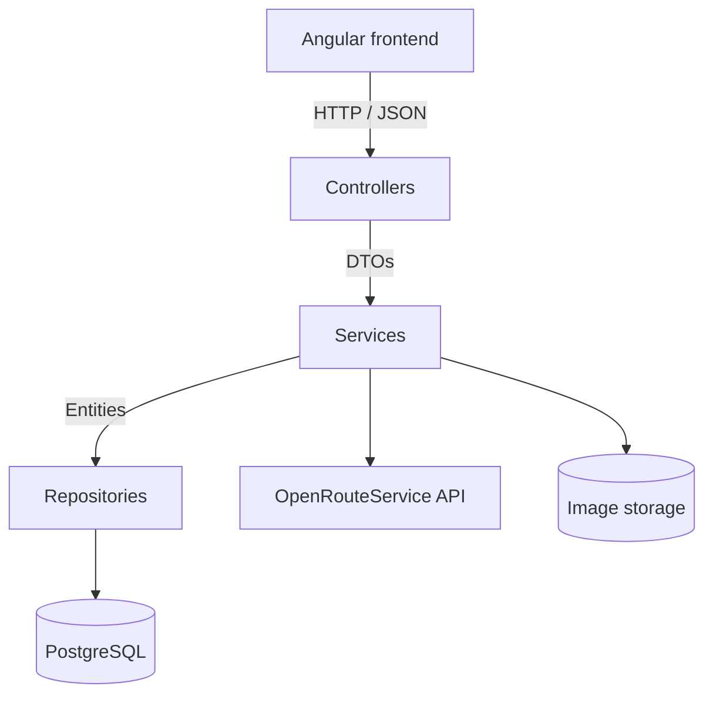

# Tour Planner

Web app for planning bike tours, hikes and runs and keeping a log of them. Semester project for Software Engineering 2 at FH Technikum Wien (summer 2026), built together with [David Kedra](https://github.com/DeeQay).

- `backend/` - REST API with Java 21, Spring Boot, Spring Data JPA and PostgreSQL
- `frontend/` - Angular 21 (standalone components and signals), Leaflet for the map

The two parts were developed in separate repositories first. I merged them here with the full commit history.

## What it does

- register and log in (passwords hashed with BCrypt, JWT that expires after 24 hours)
- create, edit and delete tours with name, description, start, destination and transport type
- distance, duration and the route itself come from the OpenRouteService API and are shown on a Leaflet map
- elevation profile for each route, drawn as an SVG chart in the browser, plus total ascent and descent
- tour logs per tour (date, comment, difficulty, distance, time, rating)
- two computed values per tour: popularity (number of logs) and child friendliness (based on difficulty, time and distance of the logs)
- full text search over tours, logs and the computed values
- upload an image per tour
- export all tours as JSON and import them again

Every user only sees their own tours. The backend checks the owner on every request.

## Architecture



The backend is split into controller, service and repository layers. Controllers only work with DTOs, entities stay below the service layer. Tour logs are deleted with `ON DELETE CASCADE` on the database level instead of JPA cascading, because the JPA way needed the lazy collection to be loaded first and that broke in our tests.

## Running it

You need Docker, Node.js and a free API key from [OpenRouteService](https://account.heigit.org/manage/key).

Backend and database:

```bash
cd backend
cp .env-copy .env        # put your ORS key into TP_ORS_API_KEY
docker compose up -d --build
```

The API runs on `http://localhost:8080`, PostgreSQL on port 5433.

Frontend:

```bash
cd frontend
npm install
npm start
```

Then open `http://localhost:4200`.

For anything other than local testing set `TP_JWT_SECRET`, otherwise a default dev secret is used.

## Tests

The backend has unit and integration tests with JUnit 5. They run against an H2 in-memory database with the real Spring context, so the JPA mappings and the cascade delete are tested too.

```bash
cd backend
./mvnw test
```

Frontend tests run with Vitest: `npm test` in `frontend/`.
